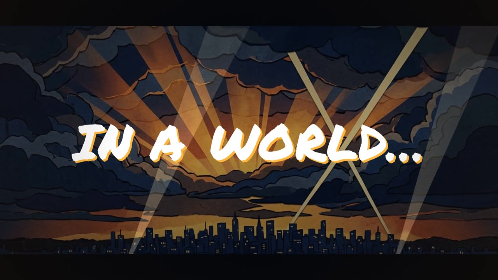

<h1 align="center">promo-clip</h1>

<p align="center"><b>Turn a product into a short animated promo video, from script to MP4, inside Claude Code.</b></p>

<p align="center">
  <a href="https://docs.claude.com/en/docs/claude-code/plugins"></a>
  <a href="LICENSE"></a>
  = 20">
  
</p>

<p align="center">
  <a href="docs/media/promo-clip-demo.mp4"></a><br>
  <sub>▶ <a href="docs/media/promo-clip-demo.mp4">Watch the 35-second demo</a>, made end to end with promo-clip (AI spend incl. all retakes: $1.08).</sub>
</p>

---

A Claude Code plugin that makes short animated promo videos for any product, in a hand-drawn
paper-collage style. You answer a few questions; Claude writes the script, gets a voice-over, music
and art (AI or your own files), animates every scene in sync with the words and the beat, and
exports MP4s in 16:9, 9:16 and 1:1.

- **Timed to the voice.** Every cue is tied to a spoken word or a music beat, never a hand-typed time.
  Change the script or the voice and the film re-times itself.
- **One film, three formats.** Landscape, vertical (Reels, TikTok, Shorts safe zone) and square from
  the same scenes, 720p to 4K.
- **You stay in charge.** Gated mode stops at every choice (brief, script, takes, track, art, stills,
  final cut). Auto mode picks the best-ranked option and logs why.
- **Bring your own anything.** Your recording, your track, your photos and screenshots. With all
  your own assets a video costs nothing beyond Claude tokens.
- **Checked before you see it.** Script-vs-voice word diff, loudness (−14 LUFS), audio/video sync,
  layout overlaps and safe zones, QR codes decoded from rendered frames.

## Install

```
/plugin marketplace add Gavin152/promo-clip
/plugin install promo-clip@promo-clip
```

Needs Node 20+ and Chrome, Chromium or Edge. AI voice, music and art need an
[OpenRouter](https://openrouter.ai/keys) key (`OPENROUTER_API_KEY` in your environment or a `.env`
in the video folder). Works on macOS, Linux and Windows.

## Make a video

```
/promo-clip                   # guided: discover → script → voice → music → art → scenes → formats → export
/promo-clip auto mode         # same, without stopping at the gates
/promo-clip:status            # where a video stands, and what it has cost
/promo-clip:music             # redo one stage; later stages are marked stale and re-run
```

Each video is a folder with its own copy of the engine, so a plugin update never changes a finished
video until you run `/promo-clip:upgrade`. Outputs land in `out/`: `<name>_<format>_<size>.mp4`
(master) and `…_web.mp4` (smaller), plus a QA report.

Scene writing runs one agent per scene in parallel. Background agents can't ask for permission, so
allow edits and `node` for them (otherwise the stage writes scenes one at a time):

```json
{ "permissions": { "defaultMode": "acceptEdits", "allow": ["Bash(node *)"] } }
```

## Costs

OpenRouter spend is tracked per stage against a budget (default $10); a call that would go over it
is refused before it is made. Typical AI asset costs: a 5-scene teaser with AI voice, music and art
came to $0.43. Claude tokens are separate and depend on your model; the parallel scenes stage is
the biggest part (about $10 for that teaser). Details in [docs/costs.md](docs/costs.md).

## Docs

- [Getting started](docs/getting-started.md): install, first video, gates, own assets, troubleshooting
- [Providers](docs/providers.md): models, keys, per-video overrides, known quirks
- [Writing scenes](docs/writing-scenes.md): timeline, scene contract, layouts per format, style API
- [Costs](docs/costs.md): prices, budget, real totals, render times

## Development

```sh
claude --plugin-dir ~/path/to/promo-clip       # run Claude Code with your local checkout
cd engine/tools && npm ci                       # esbuild, puppeteer-core, ffmpeg-static, sharp, qrcode, jsqr
node engine/tools/cli.mjs help                  # every CLI command
node --test tests/unit/*.test.mjs               # unit tests (seconds)
node --test tests/integration/*.test.mjs        # fixture pipeline in Chrome (about a minute)
node tests/make-refs.mjs                        # re-make this OS's reference stills after a visual change
```

`fixtures/sample-15s/` is a complete 15-second, 3-scene video with placeholder assets: the CI
fixture and the smallest working example of a timeline and scenes in all three formats. CI runs the
unit tests and a setup check on Linux, macOS and Windows, and the full render pipeline on each.

## Licence

Code: [MIT](LICENSE). Bundled fonts keep their own licences: Inter and Caveat under the
SIL Open Font License 1.1, Permanent Marker under the Apache License 2.0 (see
[`engine/assets/fonts/`](engine/assets/fonts/README.md)). `ffmpeg-static` downloads an ffmpeg build under its own licence (GPL) at
install time; it is not part of this repository.
